# Simple Waveform Generator

## Introduction

The waveform generator is a simple printed circuit board (PCB) designed to generate sinusoidal, triangular, and square waveforms, with usable frequencies up to 10 MHz depending on the waveform type and acceptable output distortion or attenuation. The PCB was designed as an Arduino UNO R3 shield, with the Arduino board acting as the controller. Commands can be sent through the USB port from a computer using a simple Python GUI or hardware API, providing both graphical and programmatic control.

The board also has four external digital inputs with debouncing circuits. These inputs can be connected to rotary encoders to adjust the signal frequency and amplitude. This feature is useful for implementing a standalone audio signal generator in a small enclosure.

The waveform generator PCB supports adjustment of the following output signal parameters:

- Frequency
- Amplitude
- DC offset
- Waveform type (sinusoid, triangle, or square)

The following files are provided as part of this project:

- KiCad v10.0.0 project files for the complete PCB
- Firmware source code for the Arduino UNO R3 and the associated `Makefile`
- Python GUI and hardware API

The following sections provide more details about the circuit design, PCB implementation, software control, and measurement results. The supplied files are intended to help users reproduce the hardware and explore its capabilities.

---


## Printed Circuit Board

A photograph of the waveform generator PCB is shown in Fig. 1. The bare PCB was manufactured through DigiKey's DKRed program using a four-layer stackup (www.digikey.com). The stackup is shown in Fig. 2.

<figure style="margin-bottom: 40px;">
  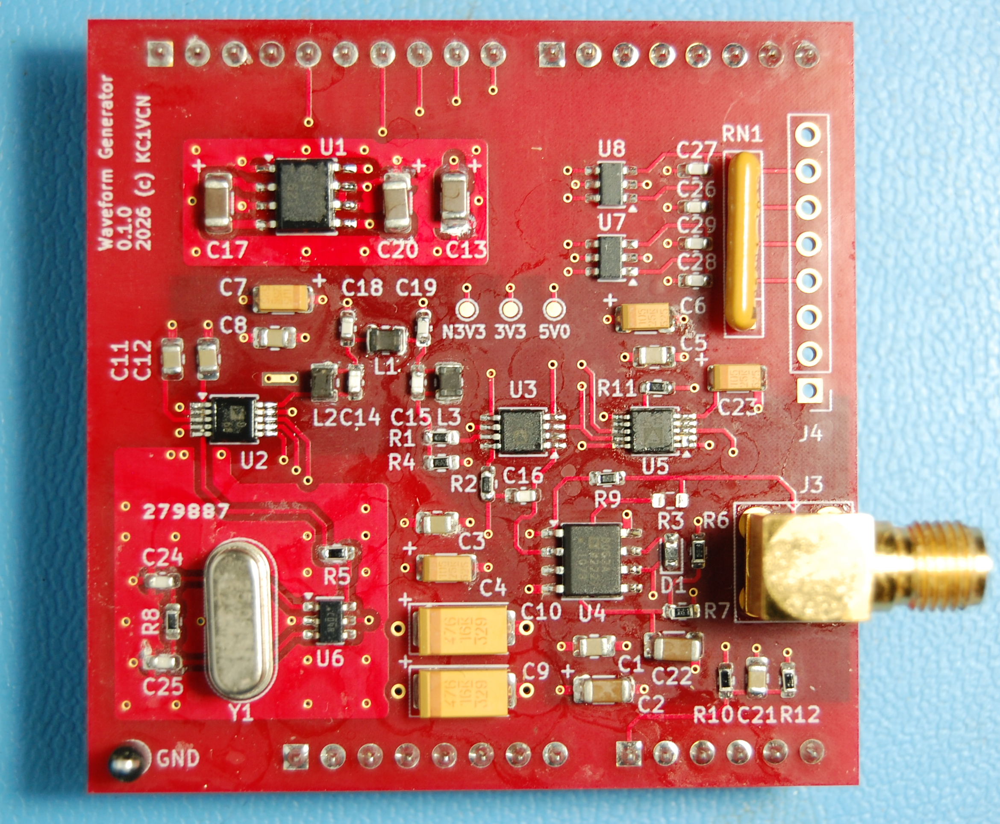
  <figcaption><b>Figure 1:</b> Printed circuit board of the waveform generator.</figcaption>
</figure>

<figure style="margin-bottom: 40px;">
  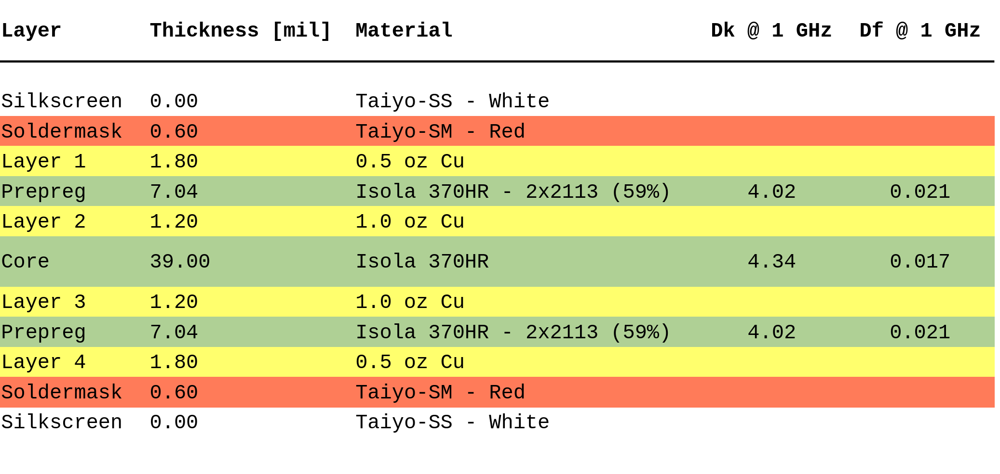
  <figcaption><b>Figure 2:</b> PCB stackup (DigiKey DKRed four-layer stackup).</figcaption>
</figure>

All surface-mount components were selected in 0603 or larger package sizes, and all IC packages were chosen without a central exposed pad and with a lead pitch of at least 0.5 mm. These choices make manual PCB assembly easier if necessary. 

For manual assembly, it is recommended to solder the header pins first while the PCB, header pins, and Arduino board are stacked together. This helps ensure that the header pins align properly with the Arduino board. Then, perform a basic DC test by powering the Arduino board and verifying the +5 V and +3.3 V supply rails on the PCB. You may then proceed with the remaining components. An ESD-dissipative work surface and wrist strap are strongly recommended. A binocular microscope is also useful for manual assembly. Finally, liquid rosin solder flux can significantly help when soldering fine-pitch IC packages by allowing the solder to flow more smoothly.

---


## Connecting the Waveform Generator

To program the Arduino UNO R3 microcontroller or control the waveform generator, connect the Arduino board to your computer using a USB cable. No additional drivers should normally be required on Linux. However, you may need to add your user account to the `dialout` group to access the USB serial port. The waveform generator receives its power from the Arduino board.

Control commands for the waveform generator are sent through the same Arduino UNO R3 USB connector. Therefore, only one application (the GUI, hardware API, or programming tool) should access the serial port at a time.

> [!NOTE]
> When the computer software opens the serial port, the Arduino board may reset as part of the normal bootloader startup sequence. If programming is not initiated, the microcontroller proceeds to the application's `main` function. Allow sufficient time for this startup sequence after opening the serial port, since the microcontroller cannot process commands immediately.

---


## Waveform Generation

The core of the waveform generator PCB is the Analog Devices AD9833 programmable waveform generator IC. With a 25 MHz reference clock, this chip supports output frequencies up to 12.5 MHz and provides a 28-bit frequency tuning word. It has two frequency registers and two phase registers, enabling FSK and PSK modulation. Once these registers are programmed with the desired frequency or phase values, the output can be switched using a register-select command. Sinusoidal, triangular, and square waveforms are supported. Since the signal path following the AD9833 is DC-coupled (with no DC-blocking capacitor), the PCB can also generate signals at very low frequencies.

To suppress unwanted high-frequency spectral components, a fifth-order elliptic reconstruction (anti-imaging) low-pass filter was designed after the AD9833. This provides a relatively clean output spectrum at frequencies up to 10 MHz. Without this filter, spectral images from the sampled waveform would become increasingly close to the desired signal as the output frequency approaches the Nyquist frequency. A relatively sharp cutoff is therefore desirable, motivating the choice of an elliptic filter design.


### Gain Control

The gain control block is based on a multiplying digital-to-analog converter (DAC) architecture. For this purpose, the Analog Devices AD5452 12-bit high-bandwidth multiplying DAC and AD8062 operational amplifier were used. This configuration provides an output voltage swing of one polarity before DC-offset adjustment. Although this approach offers a wide gain adjustment range, the DAC and the associated high-frequency compensation of the op-amp limit the overall bandwidth of the waveform generator.


### DC Offset

Since the AD8062 op-amp in the gain control stage is used in an inverting configuration, its output is negative before offset adjustment. A DC-offset control was therefore implemented to shift the output DC level. This helps to generate output waveforms with symmetric swings. The Analog Devices AD5270 digital potentiometer provides an adjustable voltage to the noninverting input of the AD8062. A series capacitor can also be added at the output to block DC completely if necessary. Note, however, that this would introduce a low-frequency cutoff.

Two points are worth mentioning regarding the AD5270 compared with the AD9833 and AD5452. First, the SPI timing configuration used for the AD5270 is CPOL = 0 and CPHA = 1, whereas the AD9833 and AD5452 are driven using CPOL = 1 and CPHA = 0. This difference must be handled in software because the ICs share the SPI clock line from the Arduino UNO R3. Second, a pull-up resistor is required on the AD5270 SPI data output (SDO) pin, even if readback is not used. Analog Devices Product/Process Change Notice PCN 10_0354 (December 14, 2010) describes a potential malfunction if the pin is left floating.


### Negative Voltage Supply

To generate the negative supply voltage required by the AD8062 op-amp, the Analog Devices MAX1680 switched-capacitor voltage converter was used. Low-ESR ceramic capacitors are important for efficient charge-pump operation and for minimizing switching ripple on the generated supply rail.

---


## Rotary Encoder Inputs

The waveform generator board supports two rotary encoders for adjusting frequency and amplitude when configured as a standalone audio signal generator. One suitable example is the Bourns `PEC09-2315F-N0015` rotary encoder. The connection diagram for the encoders is shown in Fig. 3.

<figure style="margin-bottom: 40px;">
  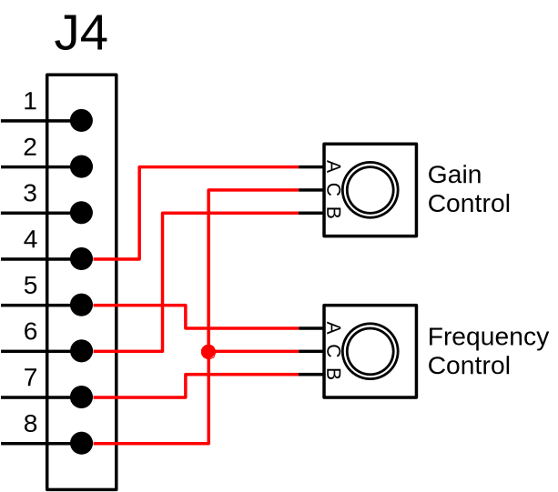
  <figcaption><b>Figure 3:</b> Connection diagram of the rotary encoders for a standalone waveform generator.</figcaption>
</figure>

In standalone operation, the generator remains within the frequency and gain limits preset in the firmware. The default limits are listed below and can be modified in the firmware source code:


| Parameter           | Value       |
|---------------------|-------------|
| Minimum frequency   | 20 Hz       |
| Maximum frequency   | 20,000 Hz   |
| Frequency step      | 100 Hz      |
| Minimum gain        | 0           |
| Maximum gain        | 4095        |
| Gain step           | 100         |


---


## Measurement Results

This section presents basic measurement results for the waveform generator. All measurements were performed using a Siglent SVA-1015X spectrum analyzer at room temperature. Note that these measurements are intended to characterize the performance of the waveform generator under the test conditions used and should not be interpreted as guaranteed specifications over the full range of operating conditions.

Fig. 4 shows the sinusoidal output level versus frequency at different gain settings. For a given gain setting, the output level remains nearly constant up to 2 MHz. Above 2 MHz, the level begins to decrease due to the limited bandwidth of the signal chain.

<figure style="margin-bottom: 40px;">
  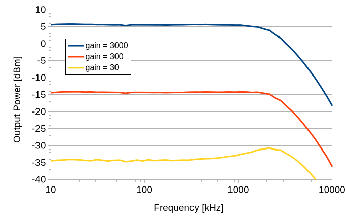
  <figcaption><b>Figure 4:</b> Output signal level vs. frequency.</figcaption>
</figure>

Fig. 5 shows the sinusoidal output level versus gain setting at different frequencies. The generator provides approximately 50 dB of linear gain-control range up to 100 kHz. Beginning near 1 MHz, this range decreases, reaching approximately 35 dB at 2 MHz.

<figure style="margin-bottom: 40px;">
  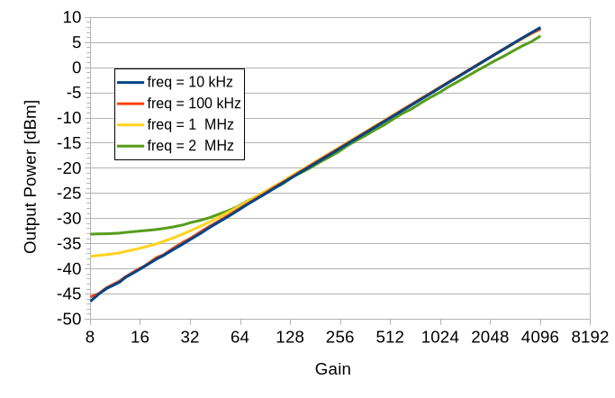
  <figcaption><b>Figure 5:</b> Output signal level vs. gain setting.</figcaption>
</figure>

The output spectra of sinusoidal signals at different frequencies are shown in Figs. 6a–6e. The gain setting for these measurements was 2048 (half scale). 

<figure style="margin-bottom: 40px;">
  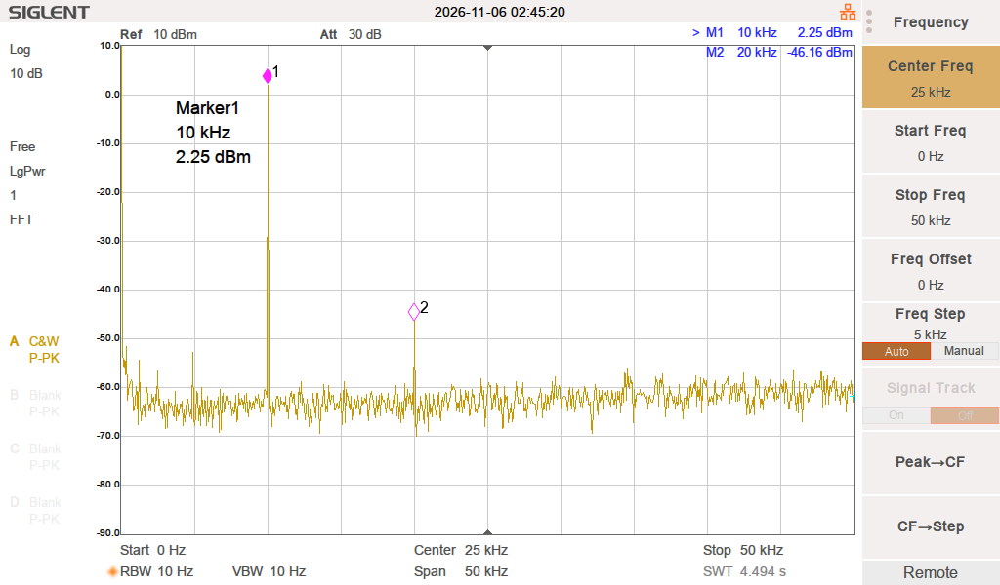
  <figcaption><b>Figure 6a:</b> Harmonic levels at 10 kHz (gain: 2048).</figcaption>
</figure>

<figure style="margin-bottom: 40px;">
  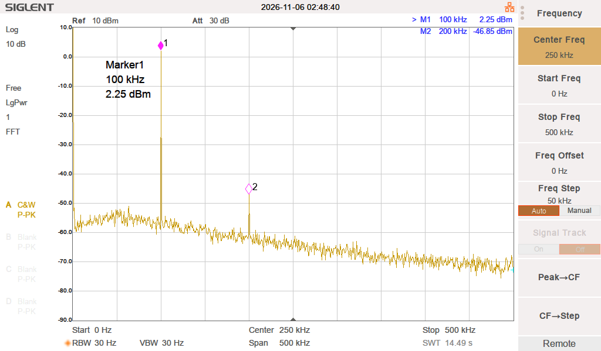
  <figcaption><b>Figure 6b:</b> Harmonic levels at 100 kHz (gain: 2048).</figcaption>
</figure>

<figure style="margin-bottom: 40px;">
  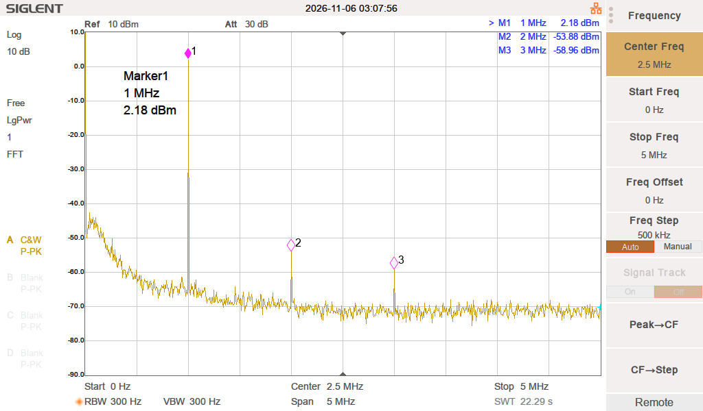
  <figcaption><b>Figure 6c:</b> Harmonic levels at 1 MHz (gain: 2048).</figcaption>
</figure>

<figure style="margin-bottom: 40px;">
  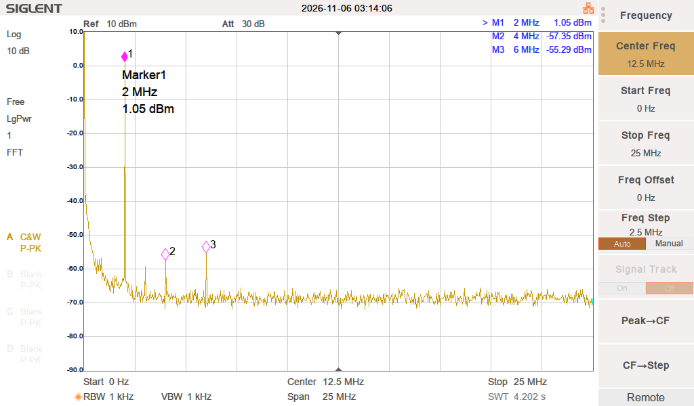
  <figcaption><b>Figure 6d:</b> Harmonic levels at 2 MHz (gain: 2048).</figcaption>
</figure>

<figure style="margin-bottom: 40px;">
  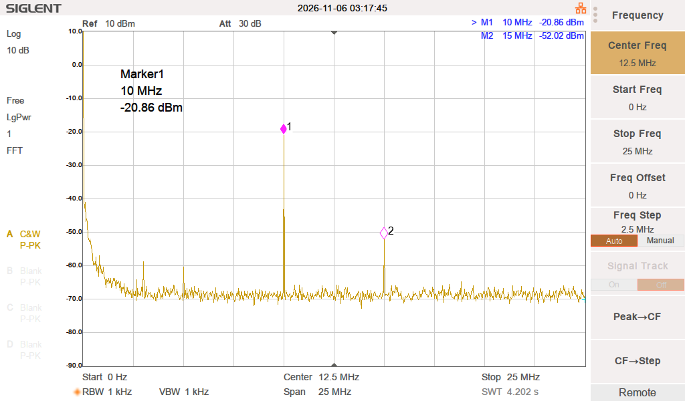
  <figcaption><b>Figure 6e:</b> Harmonic levels at 10 MHz (gain: 2048).</figcaption>
</figure>

---


## FSK and PSK Modulation

The controller also provides a simple way to test the frequency-shift keying (FSK) and phase-shift keying (PSK) capabilities of the AD9833. These features are intended only for demonstration and have not been optimized for performance. You can experiment with them using a spectrum analyzer with demodulation capabilities or a suitable demodulator. The transmitted test message is "Hello World!", but it can be changed in the Python GUI.

At the beginning of each packet, the controller transmits the following synchronization sequence. The receiver should synchronize to this bit pattern for optimal results:

```text
10101010101010100000011100010010
```

Two hardware parameters may need adjustment for reliable operation. The first is the AD9833 reference-clock frequency, which determines the generated carrier frequencies. The PCB uses a nominal 25 MHz oscillator, but the actual frequency may differ slightly. The actual clock frequency can be estimated using a spectrum analyzer or measured directly with a frequency counter. The deviation from the nominal 25 MHz can be specified through the `CLOCK_TRIM` global variable in kHz. The default correction of 8.5 kHz was determined experimentally by matching the generated carrier frequency to the spectrum analyzer reading. Since this adjustment also depends on the accuracy of the spectrum analyzer's frequency reference, it should not be considered an absolute calibration. 

The second parameter is the microcontroller clock frequency, which affects the symbol timing. The Arduino UNO R3 normally operates at 16 MHz. For simplicity, symbol timing is implemented using software-controlled delay loops rather than hardware timer interrupts. These delays are adjusted to obtain a nominal symbol rate of 3 ksps, accounting for the additional execution time introduced by the AD9833 register select commands. Although a hardware timer-based approach would provide more predictable timing, software-controlled delays were considered sufficient for this demonstration. If the received eye diagram drifts, you may need to adjust these delays.

The following figures show FSK and binary PSK (BPSK) test results obtained using the waveform generator PCB.

<figure style="margin-bottom: 40px;">
  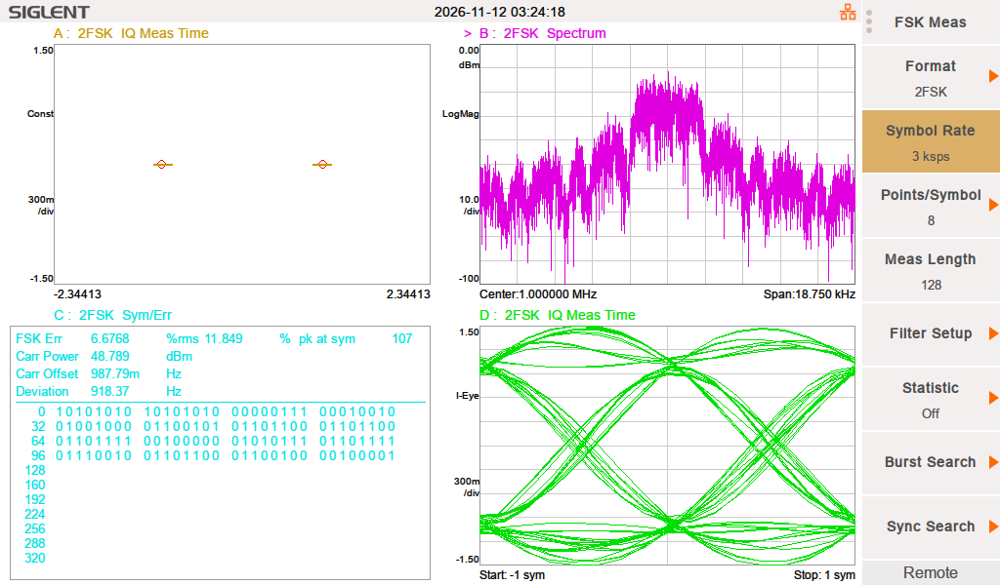
  <figcaption><b>Figure 7:</b> FSK modulation test of the waveform generator.</figcaption>
</figure>

<figure style="margin-bottom: 40px;">
  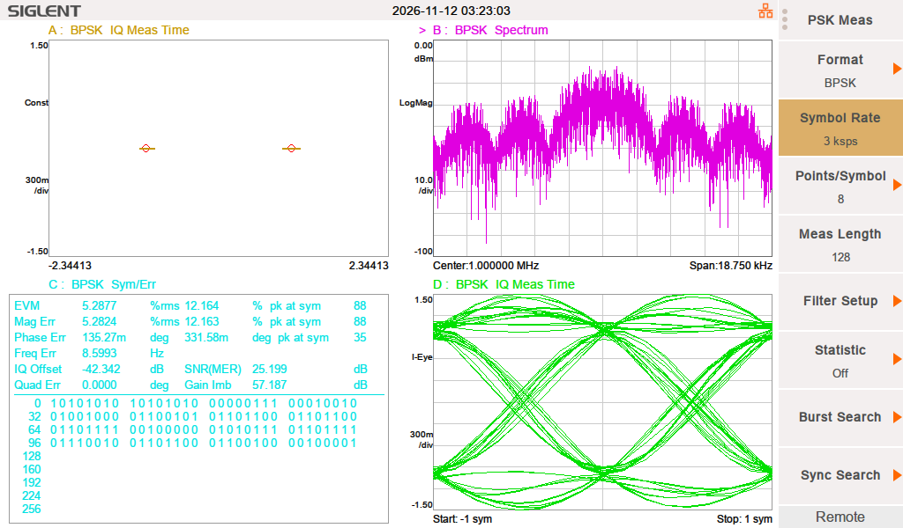
  <figcaption><b>Figure 8:</b> BPSK modulation test of the waveform generator.</figcaption>
</figure>

---


## Arduino UNO R3 Programming

The Arduino UNO R3 microcontroller can be programmed using the `avr-gcc` C compiler and the `avrdude` programming utility. The versions used during development are listed below:

| Design Tool    | Version                                     |
|----------------|---------------------------------------------|
| avr-gcc        | v7.3.0, AVR-8-bit-GNU-Toolchain-3.7.0-1796  |
| avrdude        | v7.3-20240715                               |

After installing these tools, download the firmware source files from the repository into a suitable directory. Then connect the Arduino UNO R3 board to your computer using a USB cable as described earlier.

> [!NOTE]
> After connecting the UNO R3 board, verify the serial device name assigned by Linux and update the `AVRDUDE_PORT` parameter in the `Makefile` accordingly.
>

> [!NOTE]
> Ensure that the directories containing the `avr-gcc` and `avrdude` executables are included in your `PATH` environment variable so Linux can locate the tools.
>

To compile the firmware, run the following command in the source directory:

```bash
make
```

To program the Arduino UNO R3 microcontroller, run:

```bash
make program
```

To remove previously compiled object files and start with a clean build, run:

```bash
make clean
```

---


## Graphical User Interface

A basic GUI and hardware API are provided to demonstrate the waveform generator's capabilities. Connecting an oscilloscope to the generator output while experimenting with the controls is recommended.

The GUI and hardware API were developed using **Python 3.9** on **Linux**. The reference platform was **RHEL 9.7**, although the software should also run on other Linux distributions if all dependencies are installed. The Python modules and versions used for the GUI and API are listed below. Note that the API itself requires only the `pyserial` module.

| Module      | Version |
|-------------|---------|
| PySide6     | 6.10.1  |
| pyserial    | 3.5     |


<figure style="margin-bottom: 40px;">
  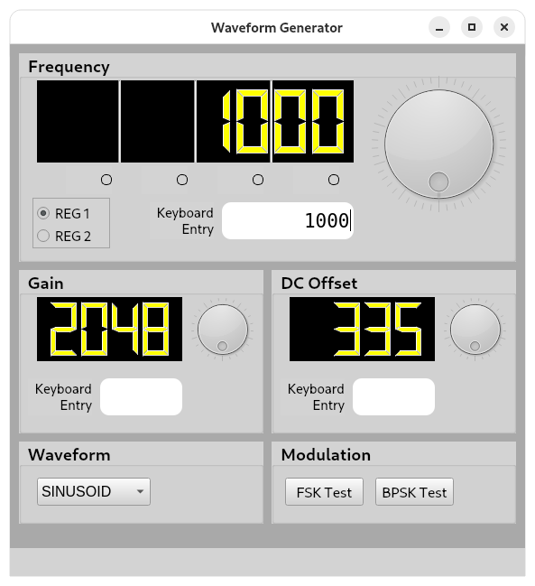
  <figcaption><b>Figure 9:</b> GUI of the waveform generator.</figcaption>
</figure>

In the GUI, each register control provides a dial knob and a keyboard entry field. The up/down arrow keys and Page Up/Page Down keys adjust the dial values in normal and larger steps, respectively. The small selector buttons below the frequency display change the tuning multiplier for the frequency dial.

The entry fields allow register values to be entered directly from the keyboard. Signed values are also supported for quickly increasing or decreasing the corresponding register value. For example, entering `+1000` in the frequency field increases the displayed frequency by 1 kHz. Holding down the `Enter` key while the field is active repeatedly increases the frequency in 1 kHz steps. 

---


## Waveform Generator Command Reference

The waveform generator firmware provides a simple, SCPI-inspired command interface for controlling the waveform generator.

### Serial Port Settings

The default serial port settings used by the firmware are shown in the following Python snippet:

```python
port = serial.Serial(p.device)

port.baudrate=57600
port.bytesize=8
port.parity=serial.PARITY_NONE
port.stopbits=serial.STOPBITS_ONE
port.timeout=0.5

port.flushInput()
port.flushOutput()
```

### API Handshake

A simple handshake protocol is implemented between the firmware and the hardware API. Before sending a command to the Arduino, the API must wait until the microcontroller sends the `READY` word. The command can then be sent. After processing the command, the microcontroller returns the `DONE` word.

The following Python snippet can be used to read handshake messages from the microcontroller. Note that this function simply returns the received message without interpreting its contents. If no message is received within approximately one second, it returns False. The calling function must check the returned value (READY, DONE, or False) and respond accordingly.


```python
def wait():
    start_time = time.time()
    timeout_expiry = start_time + 1.0

    while time.time() < timeout_expiry:
        value = port.readline().decode().strip('\n')

        if (value != ''):
            return value
    
    return False
```

### Sending API Commands and Receiving Replies

The API supports two types of commands: those that set a parameter and those that query a parameter. A command can be sent to the microcontroller using the following Python snippet:

```python
port.write(command.encode())
```

For a command that queries a parameter, the microcontroller replies with a value. The returned value can be read using the following Python snippet:

```python
value = port.readline().decode().strip('\n')
```

Note that query commands return values stored in the microcontroller memory. In the current implementation, the microcontroller does not read back the actual chip registers over SPI. These queries therefore help verify that the microcontroller received the intended values from the computer, rather than confirming the chip register contents.

The available hardware API commands are described in the following sections.

### Set Output

```
output:<freq_select>:<phase_select>:\n
```

Selects the active frequency and phase output registers. Each register selection can be either `0` or `1`. 

The synthesizer provides two frequency registers and two phase registers. Once programmed, the active registers can be switched to provide FSK or PSK modulation.

### Set Waveform

```
wave:<type>:\n
```

Selects the output waveform type. The available values are `0` (sinusoid), `1` (triangle), `2` (square, *f*<sub>out</sub>/2), `3` (square, *f*<sub>out</sub>), and `4` (reset).

### Set Frequency

```
freq:<reg>:\n
```

Sets the frequency register value of the active output. The \<reg\> parameter must be between 0 and 268,435,455.

### Set Frequency in Hertz

```
freq-hz:<freq>:\n
```

Sets the frequency of the active output in hertz. The \<freq\> parameter must be between 0 and 10,000,000.

### Get Frequency

```
freq?:\n
```

Returns the frequency register value of the active output from the microcontroller.

### Set Phase

```
phase:<reg>:\n
```

Sets the phase register value of the active output. The \<reg\> parameter must be between 0 and 4095.

### Set Phase in Degrees

```
phase-deg:<phase>:\n
```

Sets the phase of the active output in degrees. The \<phase\> parameter must be between 0 and 360.

### Get Phase

```
phase?:\n
```

Returns the phase register value of the active output from the microcontroller.

### Set Gain

```
gain:<gain>:\n
```

Sets the gain register value. The \<gain\> parameter must be between 0 and 4095.

### Get Gain

```
gain?:\n
```

Returns the gain register value from the microcontroller.

### Set Offset

```
offset:<offset>:\n
```

Sets the DC offset register value. The \<offset\> parameter must be between 0 and 1023.

### Get Offset

```
offset?:\n
```

Returns the DC offset register value from the microcontroller.


---

## License

The hardware design, PCB design files, microcontroller firmware, Python software, and other source material in this repository are licensed under the **CERN Open Hardware Licence Version 2 – Weakly Reciprocal (CERN-OHL-W-2.0)**, unless otherwise noted.

Commercial use is permitted under the terms of CERN-OHL-W-2.0. Modified Covered Source must retain the applicable Notices and include the modification notice required by the license, including the date and a brief description of the modifications. Products made using the Covered Source must provide the Complete Source or identify the Source Location as required by the license.

The full license text is provided in the [`LICENSE`](LICENSE) file, and project-specific attribution and Source Location information are provided in the [`NOTICE`](NOTICE) file.

Third-party software used with this project, including avr-gcc, avrdude, and the required Python modules, is not part of the Covered Source in this repository and remains subject to its respective license.


